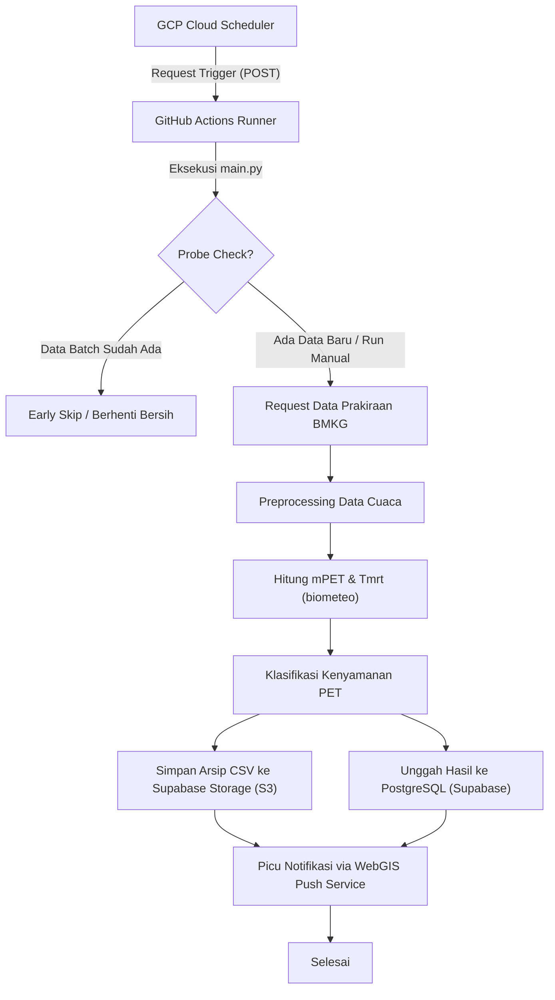

# Pipeline PET / Kenyamanan Termal (GitHub Actions Worker)

Repositori ini berisi orkestrator *pipeline* data *end-to-end* yang bertugas mengunduh data prakiraan cuaca dari API BMKG, memproses parameter meteorologi untuk menghitung indeks kenyamanan termal *Physiologically Equivalent Temperature* (PET) menggunakan pustaka `biometeo` (v0.4.1), mengklasifikasikan kategori kenyamanan termal, serta mengarsipkan hasilnya ke database PostgreSQL (Supabase) dan Supabase Storage (S3-compatible).

[](https://python.org)
[](https://github.com/features/actions)
[](https://pytest.org)
[](https://cloud.google.com/scheduler)
[](#)

---

## Daftar Isi
- [Diagram Alur Kerja](#diagram-alur-kerja)
- [Tentang Proyek](#tentang-proyek)
- [Arsitektur & Struktur Direktori](#arsitektur--struktur-direktori)
- [Fitur Utama](#fitur-utama)
- [Dependensi Utama](#dependensi-utama)
- [Prasyarat (Prerequisites)](#prasyarat-prerequisites)
- [Panduan Instalasi & Penggunaan](#panduan-instalasi--penggunaan)
- [Pengujian & Verifikasi](#pengujian--verifikasi)
- [Pemicu Jadwal Eksternal (GCP)](#pemicu-jadwal-eksternal-gcp)
- [Sinkronisasi Data Destinasi](#sinkronisasi-data-destinasi)
- [Kontribusi & Hak Cipta](#kontribusi--hak-cipta)

---

## Diagram Alur Kerja

Berikut adalah representasi alur pemrosesan data *end-to-end* dari pengunduhan hingga pembaruan dasbor:



---

## Tentang Proyek

Sistem ini dikonfigurasi untuk berjalan di lingkungan **GitHub Actions dengan runner Windows (`windows-latest`)** karena pustaka perhitungan biometeorologi (`biometeo`) membutuhkan dependensi biner Fortran/C yang telah dikompilasi khusus untuk platform Windows. 

Pipeline ini berfungsi sebagai *backend* penyedia data untuk WebGIS, memastikan data kenyamanan termal terhitung secara periodik (setiap pergantian slot waktu BMKG) tanpa intervensi manual.

---

## Arsitektur & Struktur Direktori

Repositori ini disusun menggunakan struktur paket Python standar (`src/`) agar modular, teruji, dan mudah dipelihara.

```text
action/
├── .github/
│   └── workflows/
│       ├── ci.yml                  # CI otomatis saat push/PR ke branch main
│       └── run-biometeo-worker.yml  # Definisi run-worker untuk produksi & manual
├── src/
│   └── biometeo_worker/            # Paket program utama
│       ├── __init__.py
│       ├── main.py                 # Entrypoint orkestrator pipeline & probe check
│       ├── config.py               # Manajer konfigurasi & env var
│       ├── logger.py               # Modul logging terpusat (UTC)
│       ├── biometeo_engine.py      # Integrasi Tmrt_calc & PET biometeo
│       ├── bmkg_client.py          # Client API prakiraan cuaca BMKG
│       ├── classification.py       # Klasifikasi kenyamanan (Temperate & Sub-Tropic)
│       ├── database.py             # Operasi database PostgreSQL & check batches
│       ├── destinations.py         # Master data koordinat & elevasi 49 destinasi
│       ├── destinations_source_db.py # Pengambilan konfigurasi destinasi dari DB
│       ├── preprocessing.py        # Normalisasi satuan & reduksi kecepatan angin
│       └── storage.py              # Operasi upload arsip ke Supabase Storage (S3)
├── scripts/
│   ├── smoke_test.py               # Pengujian cepat fungsionalitas biometeo
│   ├── run_local.ps1               # Script PowerShell untuk eksekusi lokal
│   └── sync_destinations_to_db.py  # Sinkronisasi master destinasi lokal ke DB
├── reports/                        # Lokasi penyimpanan laporan & keluaran CSV runtime
├── tests/                          # Berkas pengujian unit (pytest)
├── .env.example
├── .gitignore
├── pyproject.toml                  # Konfigurasi project & pytest
├── README.md
└── requirements.txt
```

---

## Fitur Utama

- **Pengecekan Batch Dini (Probe Check)**:
  - Sebelum mengunduh semua data, program melakukan request BMKG singkat untuk **3 desa sampel secara acak**.
  - Mengecek ke database apakah data dengan tanggal analisis tersebut sudah diproses.
  - Jika sudah ada, program langsung berhenti secara bersih dalam < 1 detik (**Early Skip**), menghemat kuota menit GitHub Actions runner.
- **Komputasi Kenyamanan Termal PET**: Integrasi perhitungan *Mean Radiant Temperature* (Tmrt) dan *Physiologically Equivalent Temperature* (PET) yang akurat.
- **Normalisasi Data Cuaca**: Pengambilan otomatis data BMKG, penanganan format waktu (WITA/UTC), serta penyesuaian tinggi hembusan angin (*wind speed roughness translation*).
- **Arsip Multi-Penyimpanan**: Hasil disimpan secara tabular di PostgreSQL untuk visualisasi dasbor, sekaligus diunggah dalam format CSV kompresi ke Supabase Storage (S3 compatible) sebagai arsip riset jangka panjang.
- **Keamanan Kredensial**: Manajemen aman untuk seluruh parameter sensitif menggunakan integrasi *environment variables* lokal maupun GitHub Secrets.

---

## Dependensi Utama

Detail pustaka utama yang digunakan dalam proyek ini (didefinisikan pada [requirements.txt](requirements.txt)):
*   `biometeo==0.4.1`: Pustaka utama perhitungan parameter kenyamanan termal manusia (Tmrt dan PET).
*   `pandas` & `numpy`: Pengolahan data tabular, interpolasi, dan kalkulasi matriks parameter cuaca.
*   `psycopg2-binary`: Driver konektor PostgreSQL untuk operasi database.
*   `boto3`: AWS SDK untuk Python yang digunakan untuk mengunggah arsip ke Supabase Storage via protokol S3.
*   `pytest` & `pytest-html`: Framework pengujian unit beserta pembuat laporan pengujian HTML.

---

## Prasyarat (Prerequisites)

Untuk menjalankan proyek ini secara lokal, Anda memerlukan:
- Perangkat dengan Sistem Operasi **Windows** (karena pustaka biner `biometeo` membutuhkan compiler Windows runtime).
- **Python 3.10** ke atas terinstal di sistem.

---

## Panduan Instalasi & Penggunaan

1. **Aktifkan Virtual Environment Python**:
   ```powershell
   python -m venv .venv
   .venv\Scripts\Activate.ps1
   ```

2. **Pasang dependensi package**:
   ```powershell
   pip install -r requirements.txt
   ```

3. **Konfigurasi Environment**:
   Salin file `.env.example` menjadi `.env` dan lengkapi nilainya:

   | Variabel | Deskripsi | Default / Status |
   |---|---|---|
   | `DATABASE_URL` | URI koneksi utama PostgreSQL/Supabase | *Wajib* |
   | `S3_ENDPOINT_URL` | URL endpoint S3 Supabase Storage | *Wajib* |
   | `S3_ACCESS_KEY_ID` | Access Key ID untuk S3 storage | *Wajib* |
   | `S3_SECRET_ACCESS_KEY` | Secret Access Key untuk S3 storage | *Wajib* |
   | `S3_BUCKET_NAME` | Nama bucket tempat penyimpanan arsip | `pet_analysis` |
   | `APP_ENV` | Mode runtime aplikasi (`dev` atau `prod`) | `dev` |
   | `KEEP_LOCAL_ARTIFACTS`| Menyimpan arsip keluaran lokal setelah run | `true` |
   | `OUTPUT_PARENT_DIR` | Folder utama penyimpanan laporan lokal | `reports` |

4. **Jalankan Pipeline secara Lokal**:
   Eksekusi program secara langsung menggunakan pembantu PowerShell:
   ```powershell
   .\scripts\run_local.ps1
   ```
   *Catatan: Skrip ini secara otomatis memformat `PYTHONPATH=src` dan menjalankan CLI utama pada slot `manual`.*

   Opsi parameter CLI tambahan pada `main.py`:
   - `--slot [morning|evening|manual]`: Menentukan slot waktu eksekusi run.
   - `--dry-run`: Menghitung data dan menulis file lokal tanpa mengunggah ke DB atau S3.
   - `--skip-db`: Melewati proses unggah data ke database PostgreSQL.
   - `--skip-storage`: Melewati proses unggah file arsip CSV ke S3 Storage.
   - `--max-villages [N]`: Membatasi pengolahan data hanya untuk N desa pertama (sangat berguna untuk debugging cepat).

---

## Pengujian & Verifikasi

Pengujian pada repositori ini dibagi menjadi dua tingkat pengujian otomatis:

### 1. Pengujian Unit (Pytest)
Menguji logika modul independen seperti kalkulasi normalisasi cuaca, skema database, pemecah string tanggal, dan penentu kategori kenyamanan:
```powershell
pytest
```

### 2. Smoke Test
Memverifikasi fungsionalitas dasar komputasi `biometeo` dan integritas modul worker dalam hitungan milidetik. Uji coba ini dijalankan secara otomatis di runner GitHub Actions sebelum pengujian lainnya:
```powershell
python scripts/smoke_test.py
```
Smoke test memverifikasi:
- Pustaka biner `biometeo` berhasil di-import tanpa error runtime C.
- Fungsi komputasi inti (`Tmrt_calc` dan `mPET`) menghasilkan output matematis yang valid.
- Struktur internal program `biometeo_worker` terstruktur dengan benar.

---

## Pemicu Jadwal Eksternal (GCP)

Untuk menghemat kuota eksekusi dan meningkatkan keandalan kontrol penjadwalan, repositori ini **tidak menggunakan cron scheduler bawaan GitHub Actions**.

Sebagai gantinya, jadwal eksekusi produksi pagi & sore diorkestrasi secara eksternal (menggunakan **GCP Cloud Scheduler**). Penjadwal tersebut mengirimkan request HTTP POST ke REST API GitHub (`/repos/{owner}/{repo}/actions/workflows/run-biometeo-worker.yml/dispatches`) dengan autentikasi Token PAT dan input parameter `slot` yang sesuai.

---

## Sinkronisasi Data Destinasi

Jika terdapat pembaruan data koordinat, nama destinasi, atau tinggi elevasi laut pada konfigurasi lokal di [destinations.py](src/biometeo_worker/destinations.py), data tersebut harus disinkronkan ke database menggunakan perintah:

```powershell
$env:PYTHONPATH="src"
python -m scripts.sync_destinations_to_db
```
Tambahkan bendera `--dry-run` untuk memverifikasi perubahan dan melakukan simulasi (rollback otomatis) sebelum perubahan permanen diterapkan di database.

---

## Kontribusi & Hak Cipta

Proyek ini bersifat **private** (tertutup). Seluruh hak cipta dilindungi oleh penulis dan Sekolah Tinggi Meteorologi Klimatologi dan Geofisika (STMKG). 

Hubungi penulis jika ada pertanyaan lebih lanjut terkait penelitian ini:
*   **Nama**: Ahmad Meijlan Yasir
*   **Email**: yasirahmad220504@gmail.com
*   **Instansi**: Sekolah Tinggi Meteorologi Klimatologi dan Geofisika (STMKG), Tangerang.
