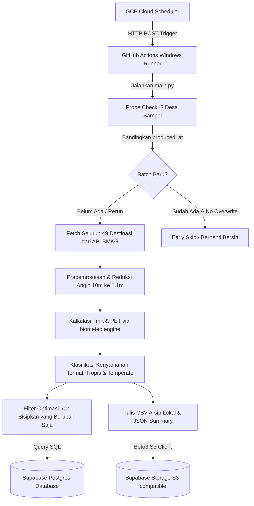

# Rangkuman Komprehensif Proyek: biometeo_worker Pipeline (action)

Dokumen ini berisi penjelasan menyeluruh, mendalam, dan terstruktur mengenai seluruh komponen teknis, arsitektur, fungsionalitas, alur komputasi, spesifikasi parameter input, dan skema pengujian dari modul **biometeo_worker (action)**. 

Modul ini bertindak sebagai orkestrator *pipeline* data *end-to-end* yang berjalan di latar belakang (backend) untuk melayani visualisasi pada **Bali PET WebGIS**.

---

## 1. Latar Belakang & Lingkup Kerja

*   **Peran Utama**: Mengunduh data cuaca dari API BMKG, menormalkannya, melakukan komputasi bio-meteorologi tingkat lanjut (Mean Radiant Temperature & Physiologically Equivalent Temperature), menyimpan hasil kueri ke database PostgreSQL, serta mengarsipkan berkas CSV ke Supabase Storage.
*   **Periodisitas**: Berjalan secara berkala (sesuai slot pagi dan sore) untuk menyajikan prakiraan cuaca 3 harian yang diperbarui secara dinamis.
*   **Runner Khusus (Windows-Latest)**: Pipeline dijalankan pada sistem operasi Windows Runner di GitHub Actions. Hal ini dikarenakan pustaka perhitungan termal `biometeo` (v0.4.1) berisi dependensi biner Fortran/C yang dikompilasi khusus untuk platform Windows.

---

## 2. Arsitektur Sistem & Aliran Data

Berikut adalah alur pemrosesan data *end-to-end* dari pemicu eksternal hingga penyimpanan akhir:



---

## 3. Struktur Direktori Kode Sumber

Berikut adalah pemetaan struktural berkas di bawah folder `action/` beserta penjelasannya:

```text
action/
├── .github/
│   └── workflows/
│       ├── ci.yml                  # Pemicu integrasi berkelanjutan (linting & test) saat push
│       └── run-biometeo-worker.yml  # Github Workflow eksekusi pipeline produksi pagi/sore
├── src/
│   └── biometeo_worker/            # Paket modul Python utama
│       ├── __init__.py
│       ├── main.py                 # Orkestrator utama, CLI parser, & alur logis pipeline
│       ├── config.py               # Pengelola variabel lingkungan (.env) & default settings
│       ├── logger.py               # Konfigurasi logging terstandar UTC
│       ├── biometeo_engine.py      # Integrasi pustaka biometeo (Tmrt_calc & PET)
│       ├── bmkg_client.py          # HTTP Client API BMKG dilengkapi retry logic
│       ├── classification.py       # Klasifikasi nilai PET ke kategori termal
│       ├── database.py             # Kueri database Postgres, upsert batch & weather_forecasts
│       ├── destinations.py         # Konfigurasi destinasi lokal (fallback file)
│       ├── destinations_source_db.py # Modul penarikan konfigurasi destinasi dari database
│       ├── preprocessing.py        # Normalisasi parameter BMKG ke input biometeo
│       └── storage.py              # Adapter upload file S3 AWS SDK (boto3)
├── scripts/
│   ├── smoke_test.py               # Pengujian fungsionalitas biometeo C-runtime dalam milidetik
│   ├── run_local.ps1               # Helper script PowerShell untuk eksekusi lokal
│   └── sync_destinations_to_db.py  # Sinkronisasi master koordinat/elevasi lokal ke database
├── tests/                          # Berkas pengujian unit berbasis Pytest
├── reports/                        # Laporan hasil uji pytest (HTML) & CSV lokal runtime
├── pyproject.toml                  # Konfigurasi paket Python & tool pytest
└── requirements.txt                # Dependensi modul eksternal
```

---

## 4. Teknologi Utama (Tech Stack)

*   **Bahasa Utama**: Python (v3.10+) untuk performa komputasi ilmiah yang stabil.
*   **Modul Sains & Matematika**:
    *   `biometeo==0.4.1`: Pustaka utama perhitungan parameter kenyamanan termal manusia (Tmrt dan PET).
    *   `pandas` (v2.x) & `numpy`: Pengolahan data tabular, pencocokan data, dan kalkulasi koordinat geografis.
*   **Konektor Layanan Awan**:
    *   `psycopg2-binary`: Driver PostgreSQL berkinerja tinggi untuk koneksi database.
    *   `boto3`: AWS SDK untuk Python yang digunakan untuk mengunggah arsip ke Supabase Storage via protokol S3.
*   **Framework Testing**:
    *   `pytest` & `pytest-html`: Otomatisasi pengujian unit dan pembuatan laporan visual HTML.

---

## 5. Spesifikasi Parameter Input (Input Parameters Specification)

Seluruh parameter input yang masuk ke dalam program dikelompokkan berdasarkan sifat nilai (statis/dinamis) dan peranannya dalam komputasi:

### A. Parameter Dinamis (Dynamic Inputs)
Merupakan parameter yang berubah setiap kali eksekusi berdasarkan data riil dari BMKG atau pemicu sistem:

| Nama Parameter | Sumber / Asal | Peran Komputasi | Keterangan |
| :--- | :--- | :--- | :--- |
| `t` / `Ta` | API BMKG | **Diolah**: Digunakan langsung dalam `Tmrt_calc` dan `PET` | Suhu udara permukaan (°C). |
| `hu` / `RH` | API BMKG | **Diolah**: Digunakan langsung dalam `Tmrt_calc` dan `PET` | Kelembapan nisbi udara (%). |
| `ws` | API BMKG | **Diolah**: Dikonversi ke m/s lalu direduksi dari 10m ke 1.1m | Kecepatan angin permukaan (km/jam). |
| `tcc` | API BMKG | **Diolah**: Dikonversi dari persen (%) ke Oktas (0-8) | Tutupan awan total (%). |
| `wd` | API BMKG | **Tidak Diolah**: Disimpan langsung ke database | Arah hembusan angin (derajat/teks). |
| `weather_desc` | API BMKG | **Tidak Diolah**: Disimpan langsung ke database | Kondisi cuaca deskriptif (misal: 'Hujan Ringan'). |
| `vs_text` | API BMKG | **Tidak Diolah**: Disimpan langsung ke database | Estimasi jarak pandang mendatar (visibility). |
| `utc_datetime` | API BMKG | **Diolah**: Di-parse menjadi objek datetime untuk komparasi | Waktu prakiraan dasar standar UTC. |
| `local_datetime` | API BMKG | **Diolah**: Digunakan untuk ekstraksi hari ke-n (`day_of_year`) dan jam aktif (`hour_of_day`) | Waktu lokal prakiraan WITA (UTC+8). |
| `slot` | CLI Flag | **Diolah**: Menentukan logika filter batch dan reaktivasi `is_latest` | morning, evening, atau manual. |
| `trigger_source`| CLI Flag | **Diolah**: Memvalidasi jam eksekusi pemicu scheduler | Contoh: '02:15', '14:15', atau 'manual'. |

### B. Parameter Spasial/Geografis Statis (Static Geographical Inputs)
Merupakan konfigurasi statis per destinasi wisata yang dimuat dari database (tabel `public.destinations` dan `public.villages`) dengan fallback file lokal `destinations.py`:

| Nama Parameter | Kategori | Peran Komputasi | Deskripsi |
| :--- | :--- | :--- | :--- |
| `latitude` | Koordinat | **Diolah**: Menentukan sudut datang matahari pada `Tmrt_calc` | Garis lintang destinasi wisata. |
| `longitude` | Koordinat | **Diolah**: Menentukan sudut datang matahari pada `Tmrt_calc` | Garis bujur destinasi wisata. |
| `sea_level_height` | Geografis | **Diolah**: Mengontrol ketebalan atmosfer pada `Tmrt_calc` | Elevasi / ketinggian dari permukaan laut (meter). |
| `kdepum_code` | Wilayah | **Tidak Diolah**: Sebagai kunci relasi ke tabel `villages` | Kode Kemendagri desa/kelurahan setempat. |
| `village_name` | Wilayah | **Tidak Diolah**: Disimpan langsung sebagai metadata arsip | Nama desa/kelurahan administratif setempat. |
| `destination_name` | Metadata | **Tidak Diolah**: Disimpan sebagai rujukan primary key destinasi | Nama Daya Tarik Wisata (DTW) destinasi. |

### C. Parameter Fisiologis Tubuh Statis (Static Physiological Inputs)
Konstanta fisiologis tubuh manusia standar yang digunakan sebagai argumen wajib (`PET_PHYS`) pada perhitungan modul `biometeo.PET()` guna menyeragamkan persepsi kenyamanan termal wisatawan:

*   `icl` (*Clothing insulation*): **0.9 clo** (asumsi pakaian kasual standar luar ruangan).
*   `work` (*Metabolic rate*): **80 W/m²** (asumsi aktivitas berdiri/berjalan santai).
*   `ht` (*Height*): **1.75 m** (asumsi tinggi badan rata-rata subjek).
*   `mbody` (*Body mass*): **75 kg** (asumsi berat badan rata-rata subjek).
*   `age` (*Age*): **35 tahun** (asumsi umur rata-rata subjek).
*   `sex` (*Gender*): **1** (laki-laki / male).
*   `pos` (*Position*): **1** (berdiri / standing).

---

## 6. Logika Utama & Algoritma Pipeline

Pipeline ini mengimplementasikan serangkaian teknik rekayasa data untuk menjamin validitas ilmiah dan performa database yang efisien:

### A. Prapemrosesan & Reduksi Angin (Wind Roughness Translation)
API BMKG menyediakan data kecepatan angin pada ketinggian standar stasiun meteorologi, yaitu sekitar 10 meter (`ws_10m`). Padahal, perhitungan kenyamanan termal PET mensyaratkan kecepatan angin pada tingkat ketinggian rata-rata tubuh manusia, yaitu **1.1 meter** (`ws_1.1m`).
*   **Prioritas 1**: Program mencoba menggunakan fungsi `v1m_cal` bawaan dari pustaka `biometeo`. Mengingat tanda tangan fungsi biner ini bervariasi, modul `preprocessing.py` secara reaktif memetakan berbagai parameter signature (`WS`, `ws`, `height`).
*   **Prioritas 2 (Fallback)**: Jika pemanggilan fungsi gagal atau modul tidak ditemukan, sistem menerapkan formula hukum daya (*power law*) eksplisit dengan koefisien gesekan angin permukaan ($\alpha = 0.2$):
    $$v_{1.1\text{m}} = v_{10\text{m}} \times \left(\frac{1.1}{10.0}\right)^{0.2}$$

### B. Normalisasi Tutupan Awan (Cloud Cover to Oktas)
Data tutupan awan dari BMKG dinyatakan dalam persentase (%). Sedangkan formula `Tmrt_calc` dari `biometeo` mewajibkan input tutupan awan dalam satuan **Oktas (0 - 8)**. Program mengonversinya menggunakan persamaan:
$$N_{\text{oktas}} = \text{clamp}\left(0.0, \frac{\text{Percent}}{12.5}, 8.0\right)$$

### C. Stabilitas Numerik Komputasi PET
Pada kondisi angin tenang (0.0 km/jam dari BMKG), input $v = 0.0$ m/s ke modul `biometeo.PET()` dapat menyebabkan pembagian dengan nilai nol (*division by zero*) pada persamaan termal internalnya, menghasilkan output `NaN`. Untuk menjaga konvergensi numerik, program secara otomatis menetapkan kecepatan angin minimum sebesar **0.1 m/s** saat angin bernilai 0.
$$\text{if } v = 0.0 \implies v = 0.1\text{ m/s}$$

### D. Pengecekan Batch Dini (Probe Check)
Untuk mendeteksi data duplikat secara efisien di awal run, sebelum mengambil seluruh data cuaca dari 49 destinasi (yang memakan waktu dan kuota request API), program mengambil 3 desa acak secara acak (*probe*).
1.  Melakukan request data prakiraan cuaca singkat ke API BMKG untuk 3 desa tersebut.
2.  Mengekstrak `analysis_date` (penanda waktu produksi batch).
3.  Memeriksa keberadaannya di database lewat fungsi `check_already_processed_batches`. Jika sudah ada, sistem mencatat status tersebut namun tetap melanjutkan pipeline dalam mode *upsert* untuk redundansi data.

### E. Optimasi Tulis Database (I/O Filtering)
Guna menghindari penulisan ulang ribuan baris data yang bernilai identik ke database Supabase (yang dapat meningkatkan latensi transaksi), sistem membandingkan data yang baru dihitung dengan data yang telah ada di database untuk batch tersebut (`existing_map`). Transaksi SQL `INSERT ... ON CONFLICT` hanya dikirim untuk baris-baris data yang mengalami perubahan nilai parameter kritis (seperti perubahan suhu, kelembapan, kecepatan angin, atau PET).

### F. Aturan Pembaruan `is_latest` (Retry Slots Prevention)
Dalam penjadwalan produksi, kegagalan jaringan atau keterlambatan pembaruan data BMKG sering kali memicu penarikan ulang (*retry slots*) pada jam berikutnya. Untuk menghindari pengiriman notifikasi berulang di dasbor client untuk data batch yang sama, program menetapkan status `is_latest = TRUE` dengan aturan:
1.  Jika eksekusi bertipe `manual` (flag `--slot manual`).
2.  Jika pemicu eksternal menargetkan slot waktu rujukan utama secara kronologis (`02:15` untuk pagi, dan `14:15` untuk sore). Jika eksekusi ulang dipicu pada jam berikutnya (misal `03:15`), status `is_latest` tidak otomatis diaktifkan kecuali jika batch tersebut memiliki timestamp produksi yang lebih baru dari batch aktif.

### G. Komparasi Datetime Aman (Timezone Alignment)
Database PostgreSQL menggunakan format timestamp tanpa zona waktu (*timezone-naive*), sedangkan API BMKG menyajikan data dengan penanda zona waktu (*timezone-aware*). Untuk menghindari kegagalan tipe data (`TypeError: can't compare offset-naive and offset-aware datetimes`), modul `database.py` secara cerdas menyeimbangkan kedua objek datetime dengan melucuti informasi zona waktu (`tzinfo=None`) atau melokalkannya sebelum melakukan komparasi kronologis.

### H. Urutan Eksekusi Pipeline (Fetch-then-Compute)
Untuk efisiensi pemanggilan API BMKG dan konsistensi data batch, program menerapkan strategi pemisahan I/O dan komputasi CPU secara sekuensial:
1. **Fetch Seluruh Desa Unik Terlebih Dahulu**: Program memanggil `fetch_all_unique_villages` untuk menarik seluruh data mentah dari API BMKG untuk semua desa unik.
2. **Preprocessing & Ekspansi**: Data mentah hasil fetch yang sukses kemudian diekspansi per destinasi (melibatkan latitude, longitude, dan elevasi spesifik destinasi tersebut) di dalam memori menggunakan Pandas DataFrame.
3. **Komputasi Biometeo (PET)**: Hasil ekspansi dihitung secara linear/berurutan menggunakan mesin biometeo (`calculate_biometeo_outputs`) untuk mendapatkan nilai Tmrt, tekanan uap, kecepatan angin 1.1m, dan indeks PET.

---

## 7. Penyimpanan & Sinkronisasi

*   **Penyimpanan PostgreSQL**:
    *   Tabel `public.forecast_batches` mencatat metadata batch dan memperbarui kolom `updated_at` dengan timestamp `NOW()` saat terjadi rerun batch agar disorot oleh service worker WebGIS.
    *   Tabel `public.weather_forecasts` menyimpan data deret waktu parameter meteorologi.
*   **Penyimpanan Supabase Storage (S3)**:
    Setiap eksekusi sukses menyimpan folder arsip bernama `pet_analysis_YYYY-MM-DD_HH-mm-SS/` berisi 5 file penting:
    1.  `raw_data.csv`: Data mentah hasil kompilasi API BMKG.
    2.  `processed_data.csv`: Data setelah melalui proses pembersihan unit dan reduksi angin.
    3.  `final_forecast_data.csv`: Data final lengkap dengan klasifikasi indeks PET (Tropis & Temperate).
    4.  `run_summary.json`: Ringkasan metadata eksekusi (durasi, jumlah baris terproses, error log).
    5.  `failed_villages.csv` (kondisional): Daftar desa yang gagal di-fetch beserta deskripsi error-nya.
*   **Sinkronisasi Destinasi (`sync_destinations_to_db.py`)**:
    Menyinkronkan konfigurasi destinasi lokal (nama destinasi, koordinat, elevasi) ke database. Mendukung flag `--dry-run` untuk memverifikasi perubahan dengan skema verifikasi join dua arah sebelum ditulis permanen ke database.

---

## 8. Sistem Pengujian & Penjaminan Mutu (QA)

Aplikasi menguji keandalan fungsionalitas komputasi, I/O database, dan storage melalui **102 skenario pengujian unit terintegrasi** yang mencakup **100% code coverage** (Statements, Branches, Functions, Lines) di bawah modul `biometeo_worker`.

### A. Metrik Cakupan Pengujian (Code Coverage)
Berikut adalah hasil persentase cakupan pengujian unit yang dijalankan melalui perintah:
`.\.venv\Scripts\python.exe -m pytest --cov=biometeo_worker --cov-report=term-missing`

```text
Name                                            Stmts   Miss  Cover   Missing
-----------------------------------------------------------------------------
src\biometeo_worker\__init__.py                     0      0   100%
src\biometeo_worker\biometeo_engine.py             71      0   100%
src\biometeo_worker\bmkg_client.py                 81      0   100%
src\biometeo_worker\classification.py              47      0   100%
src\biometeo_worker\config.py                      32      0   100%
src\biometeo_worker\database.py                   201      0   100%
src\biometeo_worker\destinations.py                22      0   100%
src\biometeo_worker\destinations_source_db.py      34      0   100%
src\biometeo_worker\logger.py                      22      0   100%
src\biometeo_worker\main.py                       268      0   100%
src\biometeo_worker\preprocessing.py              110      0   100%
src\biometeo_worker\storage.py                     39      0   100%
-----------------------------------------------------------------------------
TOTAL                                             927      0   100%
```

### B. Rincian 102 Skenario Unit Testing (Pytest)

Berikut adalah daftar berkas pengujian unit yang diuji secara otomatis beserta cakupan fiturnya:

#### 1. test_biometeo_engine_extract.py (3 Skenario)
*   **Skenario 1**: `test_extract_pet_prefers_pet_v` - Memverifikasi bahwa ekstraktor memprioritaskan kunci hasil `PET_v` keluaran pustaka `biometeo` versi 0.4.1.
*   **Skenario 2**: `test_extract_tmrt_vp_from_dict` - Memastikan nilai Tmrt dan Tekanan Uap (VP) dapat diekstrak dari format dictionary secara aman.
*   **Skenario 3**: `test_extract_biometeo_value_from_tuple` - Menguji pemrosesan jika modul biometeo mengembalikan output berupa struktur tuple.

#### 2. test_biometeo_smoke.py (1 Skenario)
*   **Skenario 1**: `test_tmrt_and_pet_finite` - Menjamin pemanggilan fungsi `biometeo.Tmrt_calc` dan `biometeo.PET` menghasilkan angka riil (*finite*) dan tidak crash.

#### 3. test_bmkg_client.py (7 Skenario)
*   **Skenario 1**: `test_validate_json_success` - Validasi parser JSON ketika respons server BMKG normal (HTTP 200).
*   **Skenario 2**: `test_validate_json_failure_status` - Melempar `ValueError` jika kode status HTTP bukan 200.
*   **Skenario 3**: `test_validate_json_non_json` - Melempar error jika konten respons bukan bertipe `application/json`.
*   **Skenario 4**: `test_validate_json_invalid_structure` - Melempar error jika struktur JSON kehilangan kunci `lokasi` atau `data`.
*   **Skenario 5**: `test_fetch_forecast_for_village_success` - Memastikan data prakiraan desa berhasil ditarik lengkap dengan metadata stasiun BMKG.
*   **Skenario 6**: `test_fetch_forecast_for_village_retries_and_fails` - Menguji mekanisme retry limit (mengulang pemanggilan) sebelum akhirnya menyerah dan mencatat kegagalan.
*   **Skenario 7**: `test_fetch_all_unique_villages` - Memastikan seluruh desa unik di-fetch secara bergantian dengan jeda request yang aman.

#### 4. test_classification.py (4 Skenario)
*   **Skenario 1**: `test_temperate_boundaries` - Menguji klasifikasi PET iklim sedang pada ambang kritis (misal: 18°C nyaman, 23°C agak hangat).
*   **Skenario 2**: `test_subtropic_boundaries` - Menguji klasifikasi PET sub-tropis/tropis pada ambang kritis (misal: 26°C nyaman).
*   **Skenario 3**: `test_nan_returns_none` - Nilai input `NaN` atau `None` harus diklasifikasikan sebagai `None`.
*   **Skenario 4**: `test_invalid_standard` - Memastikan sistem melempar `ValueError` jika standar klasifikasi tidak dikenal.

#### 5. test_config_and_runtime.py (4 Skenario)
*   **Skenario 1**: `test_load_settings_defaults_dev` - Validasi pembebanan konfigurasi default pada lingkungan pengembangan lokal (dev).
*   **Skenario 2**: `test_load_settings_default_keep_local_false_in_prod` - Memastikan pada mode produksi (`prod`), flag penyimpanan file lokal dinonaktifkan secara bawaan.
*   **Skenario 3**: `test_validate_runtime_settings_prod_keep_local_false_cannot_skip_storage` - Memblokir konfigurasi yang tidak aman jika diatur untuk tidak menyimpan lokal dan sekaligus melewati upload storage.
*   **Skenario 4**: `test_determine_set_latest` - Menguji aktivasi biner dari fungsi `determine_set_latest` berdasarkan variasi input slot dan waktu trigger.

#### 6. test_database_datetime_comparison.py (3 Skenario)
*   **Skenario 1**: `test_import_forecast_batch_datetime_comparison_naive_vs_aware` - Memastikan modul berhasil membandingkan waktu produksi database (*naive*) dengan input BMKG (*aware*) tanpa memicu error interpretasi.
*   **Skenario 2**: `test_import_forecast_batch_datetime_comparison_both_aware` - Memastikan perbandingan berjalan lancar jika kedua parameter sudah bertipe *timezone-aware*.
*   **Skenario 3**: `test_import_forecast_batch_is_latest_activation_scenarios` - Menguji aktivasi bendera `is_latest` pada batch baru atau saat batch lama diunggah ulang.

#### 7. test_database_queries.py (6 Skenario)
*   **Skenario 1**: `test_check_already_processed_batches_success` - Menguji kueri database untuk mendeteksi batch data cuaca yang sudah diproses di database.
*   **Skenario 2**: `test_fetch_destination_configs_success` - Menguji pengambilan konfigurasi seluruh destinasi wisata Bali dari database.
*   **Skenario 3**: `test_import_forecast_batch_no_insert` - Memastikan tidak ada data yang masuk jika relasi destinasi kosong atau tidak terpetakan.
*   **Skenario 4**: `test_import_forecast_batch_upsert_success` - Memverifikasi keberhasilan kueri bulk upsert data prakiraan cuaca baru ke tabel database.
*   **Skenario 5**: `test_validate_destination_configs` - Menguji validasi lapangan data destinasi spasial.
*   **Skenario 6**: `test_database_helpers_naive_conversion` - Memverifikasi konversi dinamis objek datetime agar aman dari konflik zona waktu database.

#### 8. test_pipeline_exports.py (2 Skenario)
*   **Skenario 1**: `test_build_grp_and_exports_destination_name_in_row_overrides_mapping` - Menguji jika destinasi wisata memiliki nama spesifik di baris data, ia akan menggantikan nama desa administratif pada hasil ekspor.
*   **Skenario 2**: `test_build_grp_and_exports_falls_back_to_mapping_when_destination_name_missing` - Menggunakan nama desa sebagai nama destinasi cadangan apabila kolom nama destinasi kosong.

#### 9. test_preprocessing.py (48 Skenario)
*   **Skenario 1**: `test_ws_kmh_to_ms_10m` - Validasi konversi kecepatan angin dari km/jam ke m/s dengan pembagi 3.6.
*   **Skenario 2**: `test_tcc_to_oktas` - Menguji pemetaan persentase tutupan awan (0 - 100%) ke rentang oktas (0 - 8).
*   **Skenario 3**: `test_preprocess_timezone_and_rh` - Validasi parsing zona waktu WITA dan pembatasan nilai kelembapan (RH) yang valid.
*   **Skenario 4**: `test_preprocess_rh_invalid` - Mengabaikan baris data jika nilai kelembapan (RH) berada di luar batas ilmiah (0 - 100%).
*   **Skenario 5-48**: Parameterized tests untuk menguji kecocokan konversi angin pada berbagai ketinggian and sudut.

#### 10. test_logger.py (3 Skenario)
*   **Skenario 1**: `test_logger_setup` - Memverifikasi pembentukan inisialisasi logger terpusat.
*   **Skenario 2**: `test_logger_utc_formatter` - Menjamin log mencatat waktu menggunakan format standar UTC.
*   **Skenario 3**: `test_logger_level_handling` - Menguji penanganan level logging program.

#### 11. test_storage.py (2 Skenario)
*   **Skenario 1**: `test_upload_run_folder_success` - Menguji keberhasilan upload satu folder berkas CSV/JSON ke Supabase Storage.
*   **Skenario 2**: `test_upload_run_folder_failure` - Menjamin program mencatat kegagalan berkas jika boto3 S3 client melempar error.

#### 12. test_storage_and_destinations_db.py (3 Skenario)
*   **Skenario 1**: `test_storage_content_type` - Memastikan berkas `.csv` diunggah dengan header `text/csv` dan `.json` dengan `application/json` ke server S3.
*   **Skenario 2**: `test_validate_destination_configs_missing_fields_raises` - Menolak konfigurasi destinasi wisata jika koordinat latitude/longitude tidak lengkap.
*   **Skenario 3**: `test_validate_destination_configs_ok` - Menerima konfigurasi destinasi jika semua parameter wajib terisi lengkap.

#### 13. test_main_flow.py (7 Skenario)
*   **Skenario 1**: `test_main_runs_completely` - Menguji integrasi pipeline orkestrasi sukses dari awal hingga akhir.
*   **Skenario 2**: `test_main_failure_bmkg` - Pipeline berhenti dini secara aman jika API BMKG tidak mengembalikan data apa pun.
*   **Skenario 3**: `test_main_db_insert_zero_fails` - Pipeline gagal (exit code 6) jika insert database menghasilkan 0 record.
*   **Skenario 4**: `test_main_biometeo_empty_fails` - Pipeline gagal (exit code 4) jika hasil perhitungan biometeo kosong.
*   **Skenario 5**: `test_main_storage_failed_upload` - Mengembalikan exit code 5 jika upload ke Supabase Storage menemui galat.
*   **Skenario 6**: `test_main_probe_variations_and_skipped_logging` - Menjamin fungsi probe berjalan mulus di bawah status batch yang bervariasi.
*   **Skenario 7**: `test_main_skip_storage_and_dry_run_branch` - Memverifikasi fungsionalitas flag `--skip-storage` dan `--dry-run`.
*   **Skenario 8**: `test_main_probe_empty_and_failed_status` - Menguji penanganan jika seluruh probe gagal dan menghasilkan status partial/failed.

#### 14. test_pytest_html_report.py (1 Skenario)
*   **Skenario 1**: `test_reports_dir_can_be_created` - Memastikan direktori laporan pengujian otomatis (`reports/`) dapat dibuat dan ditulisi berkas.

### B. Smoke Test (scripts/smoke_test.py)
*   Menguji pustaka C-compiled `biometeo` secara lokal di runner GitHub Actions sebelum pengujian unit lainnya berjalan.
*   Memastikan modul tidak crash saat memuat runtime, serta formula perhitungan matematika `Tmrt_calc` dan `mPET` memberikan keluaran numerik yang valid.

---
*Dokumen ini merupakan panduan teknis internal yang bersifat statis dan tidak untuk dipublikasikan ke repositori git publik.*
